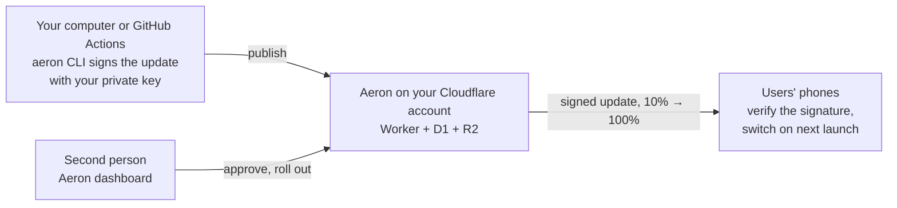

# Aeron

**Self-hosted over-the-air (OTA) updates for Expo, React Native and Flutter apps, running on your own Cloudflare account.**

Ship bug fixes and UI changes to your users' phones in minutes, without waiting for an App Store or Play Store review, and without paying a per-user fee to anyone. Every update is signed on your computer, approved by a second person, and rolled out gradually, so nobody can push code to your apps but you.

- **Works with the official clients.** Expo and React Native apps use the stock [`expo-updates`](https://docs.expo.dev/versions/latest/sdk/updates/) library. Flutter apps use Shorebird's open-source engine and CLI. Aeron replaces only their servers, so there's nothing extra to pay Expo or Shorebird.
- **Secure by design.** Updates are signed with a key that never leaves your computer or CI. Phones reject anything else, even if the server itself is compromised. New code waits for a second person's approval.
- **Safe rollouts.** Start with 10% of phones, watch the error rate, then go to 100%. Halt, undo or roll back in one click.
- **Fast and small.** Update checks are answered at the Cloudflare location nearest each phone. Phones download only the bytes that changed: in testing, a 6.3 MB bundle update became a 270-byte download, and Flutter patches were about 10 KB.
- **Cheap.** Runs entirely on Cloudflare Workers, D1 and R2. The free plan covers roughly 30,000 daily active users; beyond that it's $5 a month.
- **Easy to run.** One command sets up the server. A dashboard and plain-language docs cover everything, on macOS and Windows.

## How it works



1. **Publish.** You change your code and run `aeron expo publish` or `aeron flutter patch`. The CLI builds the update and signs it with your private key.
2. **Approve.** The update waits in the dashboard until a second person approves it. Nothing has reached any phone yet.
3. **Roll out.** Phones in the chosen share download it in the background, check the signature against the certificate built into the store app, and switch to it on the next launch.
4. **Watch and react.** The dashboard shows downloads and the error rate per update. Raise the share, or halt, undo or roll back.

Read more: [How Aeron works](docs/HOW-IT-WORKS.md).

## What you can update

| Your app | Over the air | Still needs a store release |
|---|---|---|
| **Expo** (managed) | JavaScript: screens, text, logic, styles, images | New native libraries, permissions, SDK upgrades, app icon |
| **React Native** (bare or plain, with Expo modules) | The same | The same |
| **Flutter** | Dart code: screens, text, logic | Native code and plugins, files under `assets/`, Flutter upgrades |

## Quick start

You need a free [Cloudflare account](https://dash.cloudflare.com/sign-up), [Node.js 20+](https://nodejs.org) and [Git](https://git-scm.com/downloads). New to all of this? Follow the step-by-step guide: **[Set up your Aeron server](docs/SETUP.md)**.

**1. Get the code and set up your server** (once, about 5 minutes):

```bash
git clone https://github.com/cripttion/AeornOta.git aeron
cd aeron
npm run setup
```

`npm run setup` signs you in to Cloudflare in your browser, creates the database and file storage, deploys the server and dashboard, and prints your dashboard address and a one-time setup token. It works the same on macOS and Windows, and is safe to run again at any time.

**2. Sign in to the dashboard** with the setup token, create your own admin token under **Access tokens**, then turn the setup token off:

```bash
cd apps/server
npx wrangler secret delete BOOTSTRAP_ADMIN_TOKEN
```

**3. Install the `aeron` CLI** on each computer you publish from. The dashboard shows the exact commands under **Integrations** (macOS and Windows). Details: [Install](docs/INSTALL.md).

**4. Connect an app and ship an update:**

```bash
# Expo or React Native, in the app folder
aeron expo init --app myapp --write        # keys, app.json, native files
aeron expo publish --app myapp --key keys/private-key.pem --message "Fix paywall copy"

# Flutter, in the project folder
aeron flutter init --app myapp --write     # keys, shorebird.yaml, permissions
aeron flutter release --app myapp          # the store build
aeron flutter patch --app myapp --message "Fix results screen"
```

Then approve it in the dashboard under **Approvals**. Full walkthrough: [Your first update, step by step](docs/WALKTHROUGH.md).

## Security

Aeron uses several independent layers. An attacker has to beat all of them:

| Layer | What it means |
|---|---|
| Signed on your side | Every update is signed with your private key. Phones verify it against the certificate or public key built into the store build. The server never holds a private key |
| Four-eyes approval | New code waits until a different admin approves it. A leaked CI secret or publisher token can't ship code by itself |
| Signed builds only | App builds that don't verify signatures never receive updates |
| Locked keys | A registered key can't be swapped or switched off once an app has live releases |
| No stored CI tokens | GitHub Actions authenticate with OIDC and get a one-hour token tied to a repository and branch |
| Optional SSO + MFA | With Cloudflare Access, approving needs your company login, not just a token |
| Audit log and alerts | Every publish, approval, rollback, key or token change is recorded, and can be posted to Slack or Discord |

Full model, threat table and setup checklist: [Security](docs/SECURITY.md).

## What it costs

| Cloudflare product | Free plan | When you'd pay |
|---|---|---|
| Workers | 100,000 requests a day | $5 a month for 10 million requests, then $0.30 per million |
| D1 (database) | 5 million reads and 100,000 writes a day | Included with Workers Paid |
| R2 (file storage) | 10 GB, no download fees | $0.015 per GB a month beyond 10 GB |

Each app launch makes one update check, so the free plan covers about 30,000 daily active users across all your apps. Activating R2 may ask for a payment method even though the free allowance costs $0.

## Documentation

All guides are also built into the dashboard, with search and macOS / Windows tabs.

| Start here | Guides | Reference |
|---|---|---|
| [Getting started](docs/GETTING-STARTED.md) | [Using the dashboard](docs/DASHBOARD.md) | [CLI reference](docs/CLI.md) |
| [How Aeron works](docs/HOW-IT-WORKS.md) | [Expo and React Native apps](docs/EXPO.md) | [HTTP API](docs/API.md) |
| [Set up your Aeron server](docs/SETUP.md) | [Flutter apps](docs/FLUTTER.md) | [Glossary](docs/GLOSSARY.md) |
| [Install on Mac and Windows](docs/INSTALL.md) | [GitHub Actions](docs/GITHUB.md) | [FAQ](docs/FAQ.md) |
| [Your first update](docs/WALKTHROUGH.md) | [Rollouts and approvals](docs/ROLLOUTS.md) | [Troubleshooting](docs/TROUBLESHOOTING.md) |
| | [Security model](docs/SECURITY.md) | |

## Repository layout

```text
apps/server/           The Aeron server: a Cloudflare Worker (Hono), D1 schema and the dashboard
  src/                 API routes: Expo Updates protocol, Shorebird protocol, admin API
  migrations/          Database schema (D1)
  public/              Dashboard (plain HTML, CSS and JavaScript, no build step)
  test/                Server tests, run inside workerd
packages/cli/          The aeron command-line tool (init, publish, patch, rollouts, tokens, doctor)
packages/expo-client/  Optional React hook for faster delivery and health data in Expo apps
scripts/               setup.mjs (npm run setup), docs and CLI bundling, latency benchmark
docs/                  The guides (copied into the dashboard on every deploy)
```

## Updating your server

```bash
git pull
npm run setup        # applies new database changes and redeploys; safe to repeat
```

If you publish from GitHub Actions, copy the new `AERON_CLI_SHA256` value from the dashboard's **Integrations** page into your repository variables after updating.

## Development

```bash
npm install --legacy-peer-deps
cd apps/server
printf 'BOOTSTRAP_ADMIN_TOKEN=local-dev-bootstrap-token-0123456789\n' > .dev.vars
npx wrangler d1 migrations apply aeron --local
npm run dev          # http://localhost:8787, sign in with the token above
```

```bash
npm test             # server tests (inside workerd) and CLI tests
npm run typecheck
```

In the docs, a bold line such as `**macOS**` or `**Windows**` directly above a code block turns consecutive blocks into tabs in the dashboard, and `> **Tip:**`, `> **Note:**` or `> **Warning:**` become callouts. On GitHub they render as ordinary Markdown.
